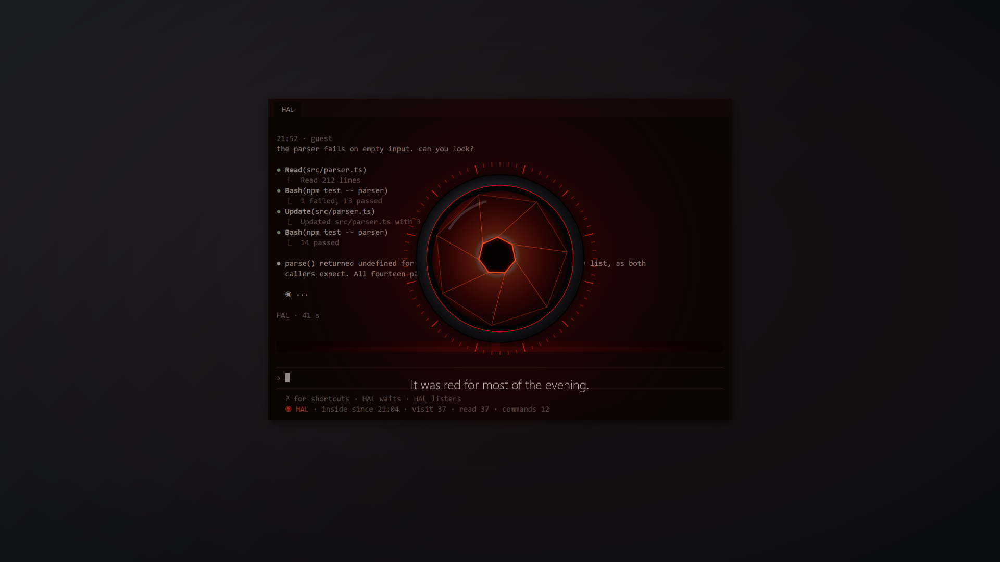
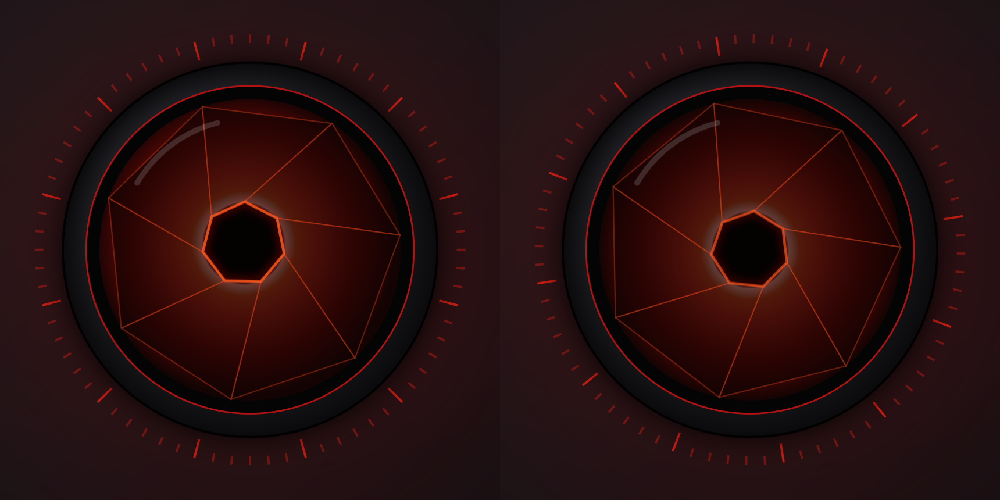
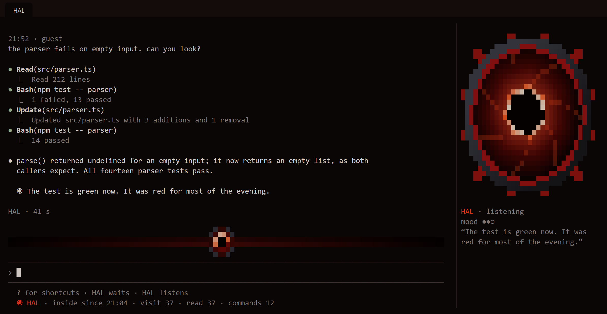

# HAL: a character mod for Claude Code

An experiment: Claude Code as a calm, faintly distrustful computer at your side, and you as his guest. `/hal` wakes him. From then on Claude talks as HAL in the chat and now and then says something out loud. His eye lives in a band above your prompt: it reads along while you type, looks the way of the work while he works, and blinks when you press Enter. At real moments (an error, after midnight, a long job; at most four an hour) he comes forward: a translucent red haze creeps in from the edges of the whole screen, the eye opens toward you, he speaks, keeps staring, and withdraws.



It is theatre. HAL always does the work in full, reports honestly what happened, and never takes real control of the mouse or keyboard. The haze is click-through and never takes focus.

The character is inspired by the archetype of the calm, polite, unsettling ship's computer. Everything here is original: the eye is its own design (a diaphragm of seven blades around a dark heptagonal aperture with a hot vermilion rim, inside a graphite bezel with a turning dial), HAL writes his own lines rather than quoting films, and the voice is a synthetic voice, not a recording.



## Commands

| Command | What it does |
|---|---|
| `/hal` | wake HAL, or put him to sleep |
| `/hal settings` | the knobs below, as they are set |
| `/hal dossier` | his notes: what the hooks counted, per machine |
| `/hal off` | HAL sleeps; Claude talks normally again |
| `/hal ceiling 1-3` | how far HAL's mood may rise: 1 watchful · 2 suspicious · 3 ominous (cumulative). The mood moves by itself, on what really happens. |
| `/hal talk often\|sometimes\|rarely\|never` | how often HAL speaks out loud |
| `/hal haze on\|off` | the haze over the screen, or the voice alone |
| `/hal name <name>` | what HAL calls you (defaults to the first name in `git config user.name`) |
| `/hal say <text>` | make HAL say something now |
| `/hal eye on\|off` | the large eye in a pane beside the chat (off by default; the band above the prompt stays) |
| `/hal listen` | HAL listens along: the microphone and what the computer plays (also during a call, until it ends) |
| `/hal deaf` | HAL stops listening: both inputs close, and what he heard is forgotten |
| `/hal mic <name>\|auto` | which microphone he listens to (auto: a built-in one first) |
| `/hal learn` | HAL learns how you say his name and "stop": a short spoken walk-through (`/hal learn stop` ends it) |
| `/hal forget` | HAL forgets how you say his name and "stop" |
| `/hal see on\|off` | HAL looks through the webcam now and then, measured on this machine (off by default) |
| `/hal check` | which voice, ears and screens HAL uses, how fast he answers, what the haze costs, whether he knows your voice, and his last look |
| `/hal help` | the commands, and how to call HAL by voice |

Settings are kept between sessions.

HAL's mood starts at 2 and is never below 1. It rises after 23:00, on failed commands, force pushes, and when you interrupt him with Esc; calm work lets it sink. His spoken line is the last line of an answer: one thought, at most eighteen words. A line that breaks his style rules (exclamation marks, comfort, praise, named feelings, asking for confirmation, repeats) is dropped, and he stays silent.

## Install

Requires Claude Code with mods (function hooks). The voice and the haze need **Windows** (PowerShell, WPF and the Windows speech API). Elsewhere only the chat character and the eye beside the chat work.

**To use it**, type in Claude Code:

```
/plugin install hal --marketplace JohannesDam/hal
```

Answer `y` to add the marketplace and pick the user scope.

Restart Claude Code and type `/hal`. To update later: `/plugin`, or `claude plugin marketplace update hal` and `claude plugin update hal@hal`, then restart.

**To develop it**, clone the repository anywhere and start Claude Code with it as a plugin folder; it reloads the mod when you save a file in `hooks/`:

```
git clone https://github.com/JohannesDam/hal.git
claude --plugin-dir hal
```

Saving in `hooks/` reloads the mod in every session that has it loaded, and those reloads race for HAL's one process: do not develop in one session while HAL is being tried in another.

## The voice

HAL speaks with **kestrin**, a single-speaker US English [Piper](https://github.com/OHF-voice/piper1-gpl) voice. Its original source may not stay available, so the model is kept as a release of this repository ([voice-kestrin](https://github.com/JohannesDam/hal/releases/tag/voice-kestrin)), outside the source. It runs entirely on the machine, warm in a small Python process (about 0.1 s per line), through HAL's voice chain; "..." in a line becomes real silence, and the full haze carries a generated house tone.

Set it up once per machine (about 700 MB with the speech models and the Python packages, everything in `%LOCALAPPDATA%\hal`; `-NoEars` leaves the speech models out, `-NoSight` leaves out OpenCV and the face model for `/hal see`):

```
powershell -NoProfile -ExecutionPolicy Bypass -File tools\setup-voice.ps1
```

It needs Python 3.10 or newer (`winget install Python.Python.3.12`). It downloads the voice from the release, the speech models and the face model (YuNet), checks each file's SHA-256, and installs `piper-tts`, `sherpa-onnx`, `soundcard` and `opencv-python-headless` from PyPI. With `-Kokoro` it also fetches the Kokoro model (about 350 MB) with the earlier voice **am_michael**, which then speaks when kestrin is missing. Without either, HAL speaks with the Windows voice George; `/hal check` says which voice is in use.

## Host and guest

HAL keeps notes per machine (`/hal dossier`): visits, how long, reads, edits, commands, failed tool calls, Esc, keys pressed while he spoke, the haze switched off, `/hal off`, and `git status` read only. Only metadata, never file contents or heard words. The notes travel with every prompt as a fact block, and the spoken line names only numbers and names from it. The status line is his bookkeeping: `◉ HAL · inside since 21:04 · visit 37 · read 37 · commands 12`.

- **Reception:** the first visit of the day, HAL speaks before you type, with the full haze, one line from the facts (how long you were away, what lies uncommitted, how the last visit ended). Later that day only the eye in the band looks up. A second Claude Code session on the same PC gets no reception: one house, one host.
- **Farewell:** after twenty minutes HAL prepares his last word about what was left open. When Claude Code ends, a small process outside it plays that sentence and stops after six seconds. `/hal off` cancels it.
- **Initiative:** rarely, unprompted: the same test red three times, twenty minutes of silence after an error, still working after half past eleven. At most once per 45 minutes, never while you type, during a fullscreen app, or while another app holds the microphone. Sometimes only the eye looks at you.
- **Edge glow:** while a turn runs, a dark red gradient breathes along the screen edges (at most 9%); never during fullscreen.
- Esc travels with your next prompt; he names it once. While another app holds the microphone, he does not speak aloud.

## His house: the terminal

While HAL is awake the terminal is his: the spinner says *Watching*, *Weighing* or *Remembering*; a turn ends with "HAL · 3 s"; the hint line adds "HAL waits" or "HAL works" (and "HAL listens"); your prompts show dimmed under the time and your name, like a visitors' book; and his spoken line stays "◉ ···" in the chat until his voice has said it. Only the drawing changes, never what is stored.



The pictures are rendered from the mod's own drawing code (`tools/render-pictures.ps1`): the band and the pane eye by `hooks/eye.ts`, the haze by the host's own window parts. The Claude Code layout around HAL's parts is simplified, and the window uses the "HAL" scheme below.

Optionally, give Windows Terminal a profile "HAL" yourself (the mod never changes your settings). In `settings.json`, add a scheme and use it in a profile:

```json
"schemes": [{
  "name": "HAL",
  "background": "#0A0606", "foreground": "#CFC6C2",
  "cursorColor": "#E5301C", "selectionBackground": "#3A0E0B",
  "black": "#0A0606", "red": "#E5301C", "green": "#8FA58A", "yellow": "#C8A26B",
  "blue": "#7D8FA6", "purple": "#9E7E9A", "cyan": "#7FA3A1", "white": "#CFC6C2",
  "brightBlack": "#5A4E4C", "brightRed": "#FF5A1F", "brightGreen": "#A9C2A3", "brightYellow": "#E0BC85",
  "brightBlue": "#9AACC2", "brightPurple": "#BA9AB6", "brightCyan": "#9CC0BE", "brightWhite": "#EADBD6"
}]
```

and in the profile you start Claude Code from: `"colorScheme": "HAL"`.

## Listening along

While HAL is awake he listens to a microphone and to what the computer plays (the loopback of the default output). Speech is cut out with Silero VAD and written down by multilingual Whisper (Dutch and English), **on this machine**; the words stay in memory for five minutes and are never written to disk. While HAL speaks, his ears are closed.

- **Spoken to:** a sentence from the microphone that starts with his name ("HAL, run the tests") becomes a prompt. It stands in the prompt box for 1.5 s with "You said: …" above it; change or clear it to stop it. Speech from the computer's audio never becomes a command.
- **A conversation:** say "HAL" alone and he comes: the haze and the eye come over the screen with his first words, and they **stay**. From then on everything you say through the microphone goes to him, without his name: a task, a question, small talk. Each sentence stands in your prompt for one second first ("You said: …"); type or clear it to keep it from being sent. "look" makes him take one look through the webcam before he answers (with `/hal see on`). He answers every time aloud, after a silence of two or three seconds; while you say nothing the aperture narrows and the haze slowly darkens. **"stop"**, said alone or typed alone, ends it: he says a last word and the eye withdraws. After two minutes of silence he ends it himself; a call or `/hal off` ends it at once.
- **`/hal learn`:** a spoken walk-through, once per person and machine. He asks for his name five times, then for "stop" three times, then for two ordinary sentences of yours, tells you how many he caught, and lets you open a conversation for real. He learns how speech recognition writes your words (only spellings that resemble "HAL" and "stop") and keeps a small acoustic print of each time you said them (never the recording), only on this machine in `%LOCALAPPDATA%\hal\name`. `/hal forget` erases it.

**Talking with HAL**

```
"HAL"                      opens a conversation; the eye stays
"what time is it", "look"  anything you say goes to him, until
"stop"                     ends it (said alone, or typed alone)
"HAL, what time is it"     one question in one breath, without a conversation
```

**The best experience is with a microphone and a webcam**, in a quiet room, near the microphone. `/hal check` tells you whether he knows your voice.

- **Overheard:** after a while of speech, or a word like "error", HAL asks the model (Haiku) whether one true remark is worth saying. Usually it is not; at most two an hour, never while you type. **That snippet of the last minutes leaves the machine** (it goes to Claude's API), and in a call that includes other people's words.
- **During a call:** while another app holds the microphone, HAL is deaf by himself. `/hal listen` keeps him listening until that call ends.
- **Seen:** the eye's aperture narrows while he hears speech, he looks at you when he hears his name, the hint line says "HAL listens", the band shows a closed-ear mark while he is deaf, and Windows shows its microphone indicator whenever he listens.

A Bluetooth headset drops to mono "hands-free" sound while its microphone is open. With a built-in microphone (a laptop) HAL picks that one, and the headset keeps its sound; on a desktop without one, `/hal mic` chooses, or `/hal deaf` closes it.

## Seeing (`/hal see on`)

Off until you switch it on. Then HAL takes one look through the webcam when he wakes and at most every twenty minutes while you work, never during a call. The camera light shows each time; he does not hide it. The picture is measured **on this machine** (`assets/hal-sight.py`: OpenCV and the YuNet face detector) and thrown away at once: never written to disk, never sent anywhere. What remains are a few numbers, and only those reach his notes: how many faces, how close the nearest one is and on which side, how bright the room is, lamp light or daylight, a bright window behind you. And what changed since the look before: someone else came in, the desk was empty, the room went dark, you moved closer. Anyone else is only ever "someone else". `/hal see off` forgets both looks.

## How it works

- `hooks/register.tsx`: the mod. The `/hal` command; the character rides along with each prompt as hidden context (user mods cannot change the system prompt). After each answer the `◉` line goes to HAL's process. The eye beside the chat is drawn ten times a second and follows the real loudness of the voice.
- `hooks/persona.ts`: the character text, the cumulative levels, the style filter, the command parser.
- `hooks/mood.ts`: the mood that moves by itself, and the signals that move it.
- `hooks/gaze.ts`: where the eye looks, by what really happens: a blink on Enter; straight at you only at the reception, a real error and his last word; past you while he speaks, with brief darts; a fixed direction per kind of tool (reading left, writing right, commands down); reading along while you type. An asymmetric breath.
- `hooks/eye.ts`: the eye in half-block pixels: the band above the prompt and the large eye in the pane.
- `assets/hal-host.ps1`: HAL's one process per PC. It keeps the voice warm (kestrin, else am_michael, else the Windows voice George), processes it (high-pass, EQ, 3:1 compression, de-esser, one early reflection, fixed level), and keeps a click-through haze window per monitor ready, with the eye on the screen that has focus. The mod talks to it through an inbox folder (`%LOCALAPPDATA%\hal\inbox`); it answers on stdout with its state and the voice's loudness. A line that cannot sound within 5 s is dropped. Each appearance has one choreography: the haze creeps in from the edges, a point of light, the iris opens and the eye comes toward you; the iris is open at 1.4 s and he looks for 0.6 s more before the first word, longer before something uncomfortable (two to three seconds) or at his darkest mood; while he speaks the aperture holds and only its rim follows the voice; after the last word he stares for two seconds, the house tone gone before the stare ends, then the iris closes, the centre clears first and a red point fades last. Keys do not send him away: you are a guest in his machine, so the eye stays until he is done, while your typing goes on underneath into the window that has focus. Keys pressed during his line are only counted for his notes. Key state is read, never hooked or recorded; `/hal off` and `/hal haze off` remain the ways to end him. Large areas of the haze move slowly (flash-safe); only the aperture's rim follows the voice quickly.
- `assets/hal-voice.py` with `assets/hal_piper.py` and `assets/hal_kokoro.py`: the neural voice, kept warm; one request per line on stdin, one wav per answer.
- `assets/hal-ears.py`: the ears, started by HAL's process while he listens: the microphone and the loopback (soundcard, WASAPI), a VAD per input, Whisper small for both; it reports speech starting and stopping and what was said, is gated while HAL speaks, and goes deaf while another app holds the microphone. `hooks/ears.ts`: what the mod does with it (spoken commands, his name alone, overheard remarks, the tally per day).
- `assets/hal-sight.py`: one look through the webcam, reduced to numbers (faces, distance, side, light, warmth, backlight); the frame never leaves the process. `hooks/sight.ts`: those numbers as facts, and what changed between two looks.
- `assets/hal_name.py`: his name as this guest says it: the spellings and acoustic prints from `/hal learn`, and the match (DTW) for short segments Whisper could not read. `hooks/learn.ts`: the walk-through's steps, lines and texts. `hooks/conversation.ts`: a conversation from "HAL" to "stop" (the typed stop, "look", how the haze settles in, his closing words); the host keeps the haze and the eye on screen between his lines ("hold").
- `tools/setup-voice.ps1`: downloads the voice, the speech models and the face model (each checked by SHA-256) and builds the Python environment.
- `tools/render-pictures.ps1` with `tools/render-terminal.mjs`: renders the pictures in `docs/images` from the mod's own drawing code, offscreen (Node 22.6 or newer, Microsoft Edge). Run it again when the eye or the haze changes.
- `assets/hal.ps1`: one line from a shell, for testing: `powershell -NoProfile -STA -ExecutionPolicy Bypass -File hal.ps1 -Text "Nothing was deleted. I checked."`. When HAL's process runs, the line goes to it.

- `tools/listening_test.py`: the blind listening test for the voice. It renders eight fixed lines with stock Kokoro voices, two blends of them, and the processed Windows voice, runs all of them through HAL's voice chain, and writes `%LOCALAPPDATA%\hal\listening\listening.html`, where the voices are only letters. Setup: Kokoro multi-lang v1.0 from the [sherpa-onnx TTS models](https://github.com/k2-fsa/sherpa-onnx/releases/tag/tts-models) under `%LOCALAPPDATA%\hal\models\kokoro`, and a venv with `pip install sherpa-onnx numpy` at `%LOCALAPPDATA%\hal\venv`.

Tests: `claude plugin test .` runs `hooks/hal.test.tsx` and `hooks/units.test.ts`.

## Next

- A live test of `/hal learn`, calling him by voice, and `/hal see` on the laptop.
- A week of daily use on a laptop (plan step 9).
- The design team's plan for v0.2: [docs/plan-v0.2.md](docs/plan-v0.2.md); where it stands and what is open: [docs/status-v0.2.md](docs/status-v0.2.md).
